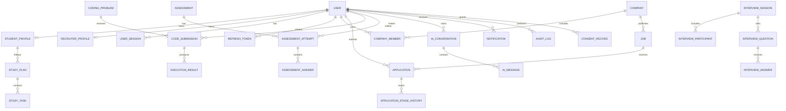

# Database Design and ERD

## Design principles

Use PostgreSQL and Prisma with UUID primary keys, UTC timestamps, foreign keys,
unique constraints, indexes on ownership/status/time filters, and transactions for
workflow transitions. JSON is reserved for genuinely flexible provider metadata,
not core relational data.

## Core model groups

- Identity: `User`, `Role`, `Permission`, `UserSession`, `RefreshToken`.
- Student: `StudentProfile`, `Education`, `Skill`, `StudentSkill`, `Project`,
  `Experience`, `Certification`.
- Recruiter/jobs: `RecruiterProfile`, `Company`, `CompanyMember`,
  `CompanyVerification`, `Job`, `JobSkill`, `Application`, `HiringStage`,
  `ApplicationStageHistory`, `RecruiterNote`.
- Resume: `Resume`, `ResumeVersion`, `ResumeAnalysis`, `ProfileSuggestion`.
- Coding: `CodingProblem`, `ProblemTopic`, `TestCase`, `CodeSubmission`,
  `ExecutionResult`, `Bookmark`.
- Assessments: `Assessment`, `AssessmentQuestion`, `QuestionOption`,
  `AssessmentAssignment`, `AssessmentAttempt`, `AssessmentAnswer`,
  `AssessmentResult`.
- Interviews: `InterviewSession`, `InterviewParticipant`, `InterviewQuestion`,
  `InterviewAnswer`, `InterviewEvaluation`, `InterviewFeedback`.
- Learning: `Subject`, `Topic`, `Subtopic`, `LearningResource`,
  `LearningProgress`, `StudentActivity`.
- Planner: `StudyPlan`, `StudyGoal`, `StudyTask`, `StudyTaskCompletion`,
  `StudyRecommendation`.
- AI: `AIConversation`, `AIMessage`, `AIUsageRecord`, `AIModelConfiguration`,
  `AIEvaluation`.
- Governance: `SecurityEvent`, `ModerationCase`, `ModerationEvidence`,
  `ModerationAction`, `Appeal`, `ConsentRecord`, `DataAccessLog`, `AuditLog`.
- Notifications: `Notification`, `NotificationPreference`.

## ER diagram

## Migration notes

The current browser records (`ios_interviews`, `ios_session`, `ios_draft`,
`ios_bookmarks`, `ios_goals`, jobs, applications, and audit records) are not a
portable production schema. A data-migration utility should be designed after
the target Prisma schema is approved; no automatic conversion is claimed here.

The field-level contract, enum set, indexes, relation constraints, and deletion
policies are defined in [FINAL_PRISMA_SCHEMA.md](./FINAL_PRISMA_SCHEMA.md). That
document is the source of truth for executable Prisma design; this ERD remains
the relationship overview.
